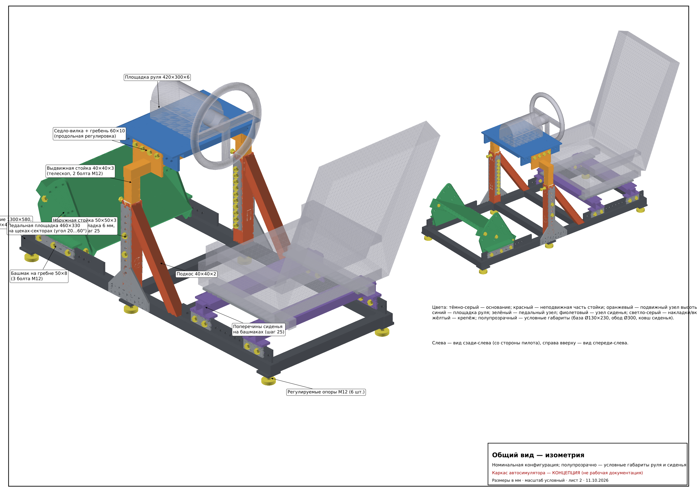
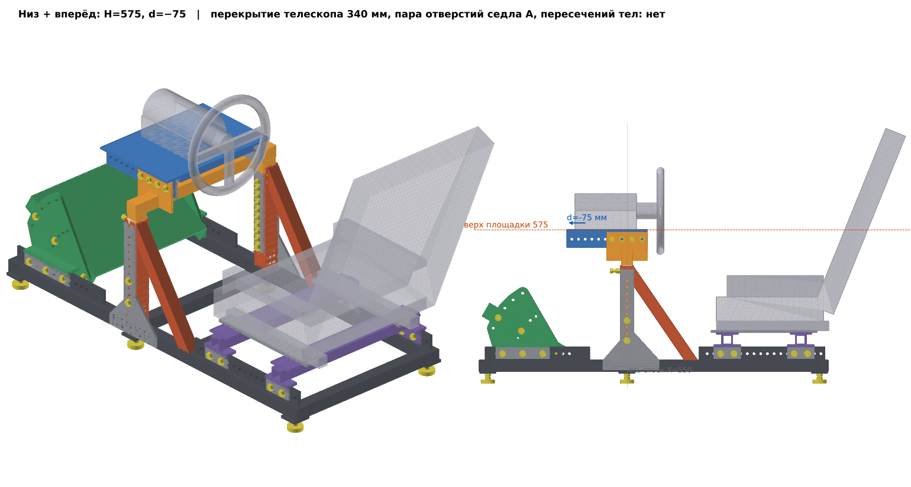
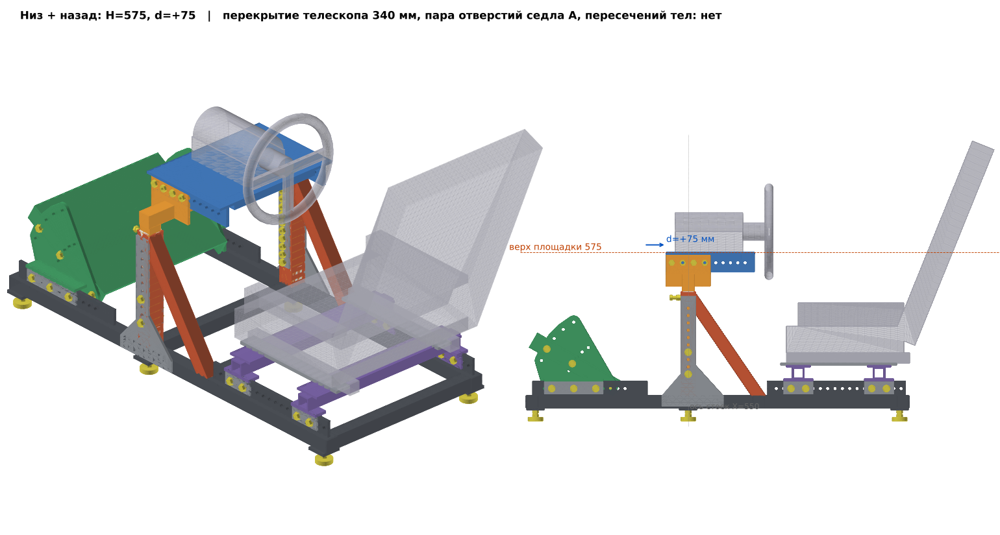
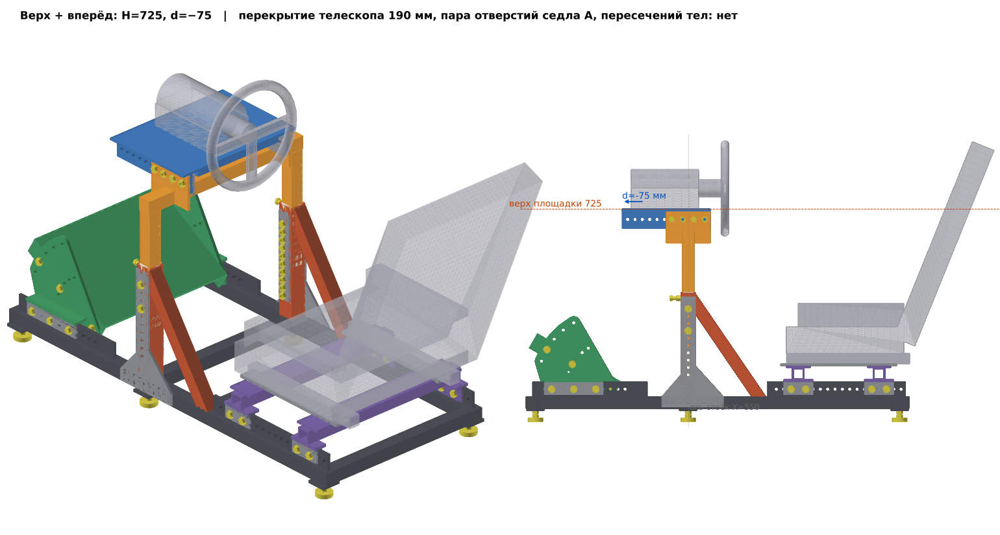
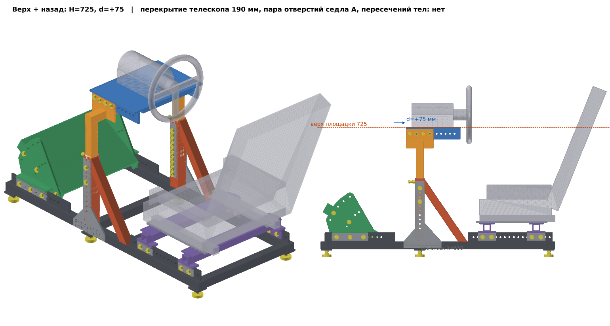

# Регулируемый сварной каркас домашнего автосимулятора — КОНЦЕПЦИЯ

> **Этап: концептуальная 3D-модель для проверки компоновки.** Это не рабочая документация и не
> производственная спецификация. Отверстия под конкретные руль, педали и сиденье не проектировались.
> Размеры в мм. **[П]** — предварительные параметры, **[!]** — требуют инженерной проверки или
> уточнения после выбора оборудования.



## Ключевые параметры [П]

| | |
|---|---|
| Основание | 1300 × 580, труба 40×40×3 / 40×40×2, 6 регулируемых опор М12 (база 45 ± 15 от пола) |
| Рулевые стойки | 50×50×3 на X = 550, косынки-накладки 6 мм, подкосы 40×40×2 |
| Высота площадки руля | **575…725, шаг 25** (7 положений), номинал 650; телескоп 50/40, 2 болта М12 на стойку |
| Руль вперёд-назад | **±75, шаг 12.5** (13 положений), гребни 60×10 в сёдлах-вилках, 4 болта М12 |
| Площадка руля | 420 × 300 × 6 (исходно 420 × 260 — увеличено, см. концепцию) |
| Педальная площадка | 460 × 330 × 6, угол **20…60°, шаг 10°**; ось качания X = **260…385, шаг 25** |
| Сиденье | 2 поперечины 40×40×3 + полка 80×6 на X = **875…1250, шаг 25**; адаптеры без отверстий |
| Масса стали | ≈ 80 кг |
| Крепёж регулировок | М12 8.8 в круглых отверстиях, приварные гайки DIN 929, стопорные шайбы-пары |

## Крайние положения руля (отдельные 3D-изображения)

| Низ + вперёд (H 575, d −75) | Низ + назад (H 575, d +75) |
|---|---|
|  |  |
| **Верх + вперёд (H 725, d −75)** | **Верх + назад (H 725, d +75)** |
|  |  |

Во всех 11 проверенных конфигурациях (крайние положения руля, педалей, сиденья) пересечений тел нет
(`out/interference_report.json`).

## Что где лежит (соответствие пунктам задания)

| № | Требование | Файлы |
|---|---|---|
| 1 | Концепция и обоснование решений | [`docs/01_concept.md`](docs/01_concept.md) |
| 2 | 3D CAD-сборка из отдельных деталей | 188 отдельных тел в группах-подсборках: `out/step/*.step` |
| 3 | STEP AP214 / AP242 + исходник CAD | `out/step/simrig_nominal_AP214.step`, `simrig_nominal_AP242.step`, крайние конфигурации `simrig_<config>_AP214.step`; исходник — параметрическая модель CadQuery `cad/*.py` |
| 4 | STL | `out/stl/simrig_nominal_frame.stl` (каркас), `simrig_nominal_with_refs.stl` (с условными рулём/сиденьем), `simrig_<config>.stl` |
| 5 | Размерные общие виды | `drawings/S01_isometric.png`, `S02_side.png`, `S03_front.png`, `S04_top.png` |
| 6 | Крупные виды механизмов | `drawings/S05_height_mechanism.png`, `S06_foreaft_mechanism.png`; крайние положения — `S07_wheel_extremes.png`, `drawings/3d/` |
| 7 | Схемы регулируемых соединений | `drawings/S09_joint_schemes.png`, `S08_pedal_unit.png`, [`docs/02_adjustable_joints.md`](docs/02_adjustable_joints.md) |
| 8 | Предварительная ведомость материалов и крепежа | [`docs/generated/bom.md`](docs/generated/bom.md) |
| 9 | Параметры к уточнению после выбора оборудования | [`docs/04_open_parameters.md`](docs/04_open_parameters.md) |
| 10 | Почему соединения не смещаются и не расшатываются | [`docs/02_adjustable_joints.md`](docs/02_adjustable_joints.md) §2.1, 2.2, 2.6 |
| — | Нагрузки, допущения, расчёт | [`docs/03_loads_and_checks.md`](docs/03_loads_and_checks.md), [`docs/generated/calc_results.md`](docs/generated/calc_results.md) |
| — | Эргономика P5…P95 | `drawings/S10_ergonomics.png`, `cad/ergonomics.py` |
| — | Изготовление и сборка | [`docs/05_fabrication_assembly.md`](docs/05_fabrication_assembly.md) |

Все листы одним файлом: `drawings/simrig_concept_drawings.pdf`.

## Как пересобрать

```bash
pip install cadquery matplotlib scipy
python cad/build.py        # STEP/STL всех конфигураций + проверка столкновений
python calc/frame_fem.py   # стержневая МКЭ-модель, проверки крепежа
python cad/bom.py          # предварительная ведомость
python cad/drawings.py     # листы чертежей и 3D-изображения
```

Все размеры — в `cad/params.py`; конфигурации регулировок — `CONFIGS` там же. Система координат:
X от переднего торца к сиденью, Y — поперёк (+ справа от пилота), Z — от пола.

## Ограничения
* Трубы смоделированы без радиусов скругления углов; сварные швы не моделировались.
* Руль, база, сиденье и манекены — условные габариты для проверки компоновки.
* Расчёт — оценочный (идеально жёсткие стыки); реальные перемещения ожидаются в 1.5–3 раза больше.
